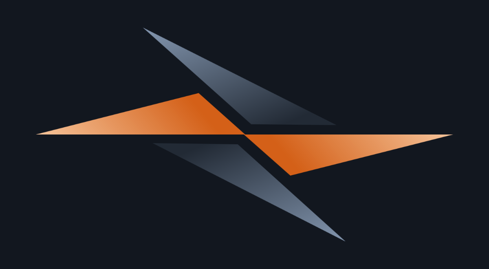
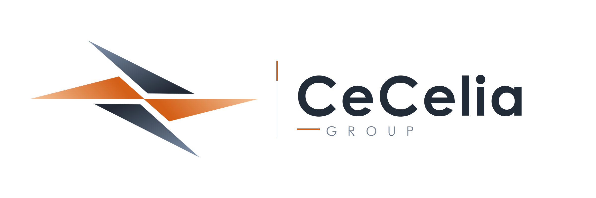
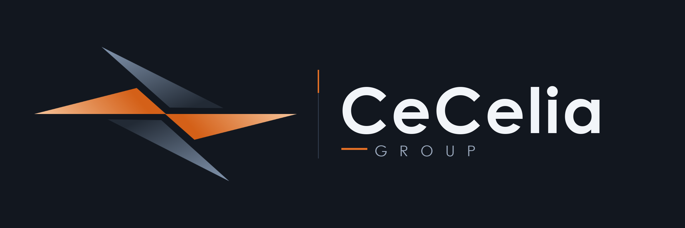
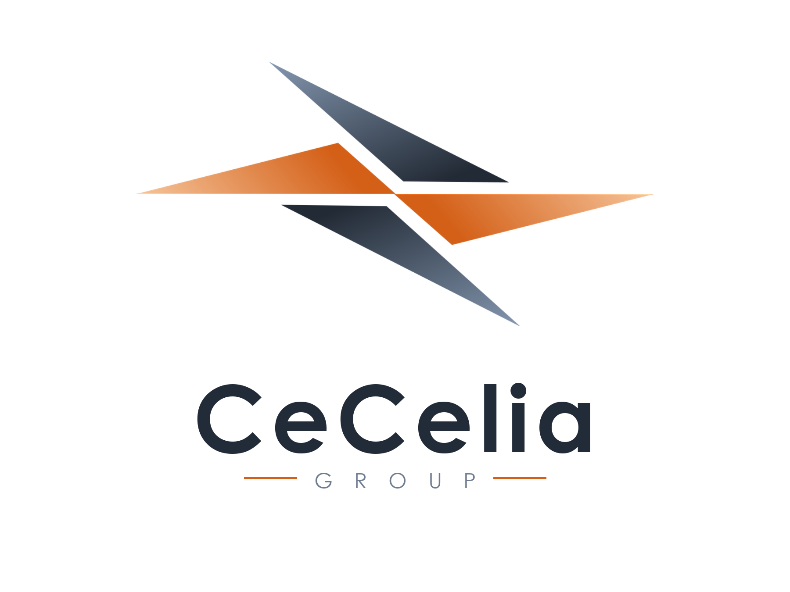
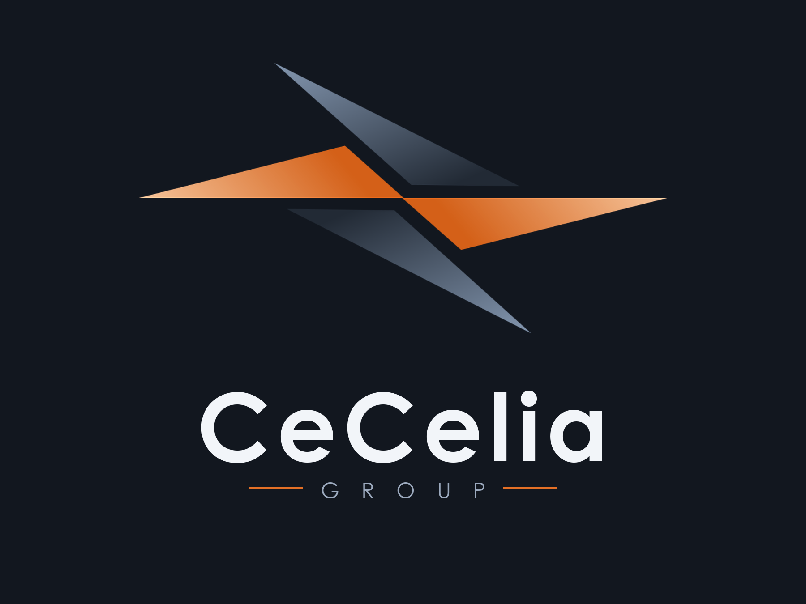

# CeCelia Group コーポレート・アイデンティティ（社章・企業ロゴ規定書）
**プロジェクト:** Arkシンジケート / CeCelia Group 公式設定ドキュメント  
**管理部門:** 首脳部直属 総務部 / 外務部  
**最終更新:** 2026年11月7日  

---

## 1. 社章（Corporate Emblem）：「生存の羅針（The Compass of Survival）」

### 1.1 デザインの象徴性と意匠設定
CeCeliaが掲げる社章（エンブレム）は、国家の紋章や政治的イデオロギーの象徴ではなく、タルトディッシュ連邦崩壊を生き延びた者たちが掲げた**「生存の印」**であり**「4つの実務指針（羅針）」**を幾何学的に抽象化したものです。

* **水平に伸びる2枚の翼（CeCelia Amber Orange）**:
  * 中心の一点で交差し左右へ鋭く伸びるオレンジの翼は、生命の灯火と人命救助の現場実務である**「医療（Medical）」**と**「製薬（Pharmaceutical）」**を象徴します。
  * どのような極限状況にあっても決して途切れない「生の連続性（地平線）」を表しています。
* **斜めに交差する2枚の翼（Deep Slate Navy）**:
  * 上下から中心を挟み込むように配置されたダークスレートの翼は、冷徹な知性である**「研究（Research）」**と、共同体を外敵から守り抜く**「警備・防衛（Security）」**を象徴します。
  * オレンジの生命線に一切触れることなく外側から護衛する配置は、「政治や暴力が医療・生命の領域を侵してはならない」という組織の厳格な自律規範と防壁を意味しています。

---

## 2. 企業ロゴ（Corporate Logo Lockups）

### 2.1 横組みロゴ（Horizontal Lockup）
公式文書ヘッダー、病院・研究施設のサインボード、病院船の船体塗装、医療物資コンテナのマーキング等に標準採用されるメインロゴです。

* **ライトモード（標準白背景用）**

* **ダークモード（夜間・暗色背景・端末UI用）**

### 2.2 縦組み・センターロックアップ（Vertical / Centered Lockup）
共同体の「生存の旗（フラッグ）」、首脳部公式声明書、IDカード、制服・警備部隊パッチ（ワッペン）等に用いられる象徴的レイアウトです。

* **ライトモード**

* **ダークモード**

---

## 3. コーポレートカラー規定（Color Palette）

| カラー名称 | 役割 | HEXコード | RGB値 | 象徴する意味 |
| :--- | :--- | :--- | :--- | :--- |
| **CeCelia Core Amber** | 社章メイン（中心側） / アクセント | `#D46018` | `RGB(212, 96, 24)` | 絶えることのない生命の灯火、救命への意志 |
| **Apricot Horizon** | 社章グラデーション（先端側） | `#F6C49A` | `RGB(246, 196, 154)` | 夜明けの地平線、再生と温もり |
| **Abyssal Slate Navy** | 社章サブ（内側） / タイポグラフィ | `#1B222C` | `RGB(27, 34, 44)` | 国家や政治に流されない冷徹なリアリズム・沈黙 |
| **Steel Mist Blue** | 社章グラデーション（外縁側） | `#8294AD` | `RGB(130, 148, 173)` | 鋭利な知性、研究と防壁 |

---

## 4. アセットファイル一覧（`assets/` ディレクトリ）

| ファイル名 | 形式 / サイズ | 用途 |
| :--- | :--- | :--- |
| [CeCelia_Emblem_Transparent.png](./assets/CeCelia_Emblem_Transparent.png) | 透過PNG (`1024×525`) | 社章単体（背景透過・汎用合成用） |
| [CeCelia_Emblem.svg](./assets/CeCelia_Emblem.svg) | ベクターSVG | 社章単体（無限拡大対応・Web/印刷用ベクターデータ） |
| [CeCelia_Emblem_WhiteBG.png](./assets/CeCelia_Emblem_WhiteBG.png) | PNG (`1024×525`) | 社章単体（白背景） |
| [CeCelia_Emblem_DarkBG.png](./assets/CeCelia_Emblem_DarkBG.png) | PNG (`1200×660`) | 社章単体（ダーク背景プレビュー） |
| [CeCelia_Logo_Horizontal_Transparent.png](./assets/CeCelia_Logo_Horizontal_Transparent.png) | 透過PNG (`2400×800`) | 企業ロゴ横組み（背景透過） |
| [CeCelia_Logo_Horizontal_Light.png](./assets/CeCelia_Logo_Horizontal_Light.png) | PNG (`2400×800`) | 企業ロゴ横組み（ライト背景） |
| [CeCelia_Logo_Horizontal_Dark.png](./assets/CeCelia_Logo_Horizontal_Dark.png) | PNG (`2400×800`) | 企業ロゴ横組み（ダーク背景） |
| [CeCelia_Logo_Vertical_Transparent.png](./assets/CeCelia_Logo_Vertical_Transparent.png) | 透過PNG (`1800×1350`) | 企業ロゴ縦組み（背景透過） |
| [CeCelia_Logo_Vertical_Light.png](./assets/CeCelia_Logo_Vertical_Light.png) | PNG (`1800×1350`) | 企業ロゴ縦組み（ライト背景） |
| [CeCelia_Logo_Vertical_Dark.png](./assets/CeCelia_Logo_Vertical_Dark.png) | PNG (`1800×1350`) | 企業ロゴ縦組み（ダーク背景） |
