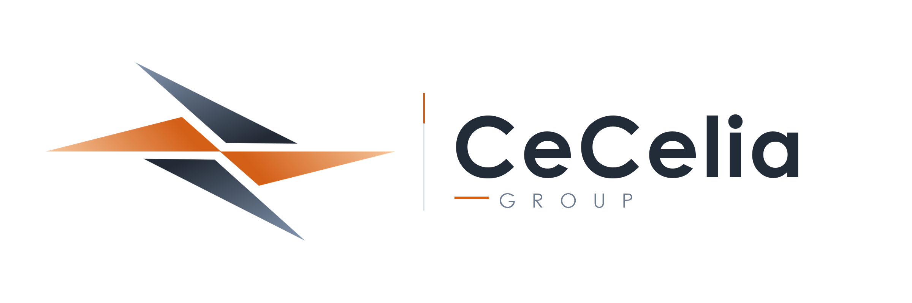

# CeCelia Group（セセリア・グループ）包括設定資料集
**プロジェクト:** Arkシンジケート / CeCelia Group 公式設定ドキュメント  
**最終更新:** 2026年11月7日  
**統括・監修:** CeCelia Group 設定アーカイブ  


*(※社章・企業ロゴの各バリエーションおよびカラー規定の詳細は [CeCelia_Corporate_Identity.md](file:///c:/Users/simad/OneDrive/Desktop/%E8%BB%8D%E4%BA%8B%E9%83%A8/CeCelia_Corporate_Identity.md) を参照)*  

---

## 1. 組織の基本理念と本質：「奇妙で歪な社会的共同体」

CeCelia Group（セセリア・グループ / 表記: CeCelia Group, CC Group）は、表面的には国際経済連合体「THE A.R.K.C. SYNDICATE（アルカンシエル企業連邦）」に名を連ねる企業体の一つですが、その実態は一般的な営利企業や政治組織とは一線を画す、極めて特異な**「生存のための社会的共同体」**です。

### 1.1 原点：タルトディッシュ連邦崩壊事件
CeCeliaの根底にあるのは、かつての故郷であった**「タルトディッシュ連邦」**が一夜にして地図上から消失した未曾有の崩壊事件です。
国家が瓦解し、日常と生活基盤のすべてを奪われた際、世界のいかなる公的機関・他国も手を差し伸べることはありませんでした。
「国家は人を救わず、世界は見て見ぬふりをした」――この過酷な原体験が、CeCeliaの成員に**「国家という制度への根本的不信」**と**「冷徹な現実主義的生存哲学」**を決定的に刻み込みました。

### 1.2 「無冠詞さ」と冷笑的リアリズム
CeCeliaの態度は徹底して**「無関心」**であり**「無冠詞」**です。
* **政治・理念への冷笑:** 国家や政治家が掲げる高邁な理念、大義名分、道徳的スローガンを、彼らは「欺瞞であり虚構」として骨の髄まで理解しています。理想を語る者を軽蔑するのではなく、「少しばかり滑稽なもの」として眺める皮肉な明晰さを持ちます。
* **生存の旗:** 彼らが掲げる旗は、領土や国家、思想の象徴ではなく、崩壊を生き延びた者たちが本能的に掲げた**「生存の印（サバイバルの証明）」**にすぎません。
* **核心の矛盾:** **「国家を信じず、世界を冷笑し、それでもなお人を救うために動く」**。この強烈な逆説と矛盾こそが、CeCeliaを突き動かす唯一無二の原動力となっています。

---

## 2. Arkシンジケートとの関係性：高度な独立と形式的所属

```
[THE A.R.K.C. SYNDICATE 統括本部]（会長: 如月 蓮華）
 ├── K1 Group（主導・PMC・航空）
 ├── Atlanta Group（インフラ・都市開発）
 ├── Revenant Group（特殊作戦・セキュリティ）
 └── CeCelia Group ★（極めて高い独立性を維持し、政治的関与・発言を徹底回避）
       │
       ├── 【首脳部 (Executive Leadership：計13名)】
       │     ├── Group Leaders（CEO: 八月立夏 / 副CEO / 情報分析室長 / 秘書室長）
       │     ├── 5管理部門長（人事 / 外務 / 倫理監査 / 総合ロジ / 総務）
       │     └── 4事業部門長（医療 / 製薬 / 研究 / 警備）
       │
       ├── 【首脳部直属室】秘書室、情報分析室
       │
       ├── 【首脳部直属 5管理部門】
       │     ├── 人事部（採用・配置・共同体構成員の生活福祉支援）
       │     ├── 外務部（シンジケート実務折衝・受入国政府外交・回廊交渉）
       │     ├── 倫理監査部（生体研究・臨床倫理監視・組織内不正監査）
       │     ├── 総合ロジ部（拠点間サプライチェーン統括・戦略備蓄）
       │     └── 総務部（財務・資金管理・法務・施設庶務等のその他業務を一括担当）
       │
       └── 【4大事業部門】
             ├── 医療部（獣人医療部、病院部、病院船部、航空救急搬送部、災害即応医療部）
             ├── 製薬部（創薬開発部、医薬製造・品質管理部、特殊製剤・獣人薬部、医薬流通サプライ部）
             ├── 研究部（基礎研究部、応用研究部、バイオデータ解析部、環境・生存工学研究部）
             └── 警備部（自社施設保安部、輸送・拠点防護隊、サイバー防護室）
                   └── PMC統括・管理部 ── 傘下PMC群（Vancat Warriors 等 ※現場独立指揮）
```

CeCeliaはArkシンジケートの設立母体・主要グループの一角として加盟していますが、その関わり方は極めて希薄かつ形式的です。

1. **消極的関与と独自の沈黙:**
   * シンジケートの全体会議や政治的意思決定において、政治的発言を避け、議決権を行使しないこともしばしばです。
   * これはシンジケートへの「敵対」や「抵抗」ではなく、「もはや国家や政治の語彙に自分たちの生存を委ねる意味を見出していない」という根本的な無関心に基づいています。
2. **実務的・経済的メリットのみの享受:**
   * 医薬品の流通網確保、医療インフラの資材調達、各拠点間の移動・物流の便宜など、純粋に「共同体の維持と生存」に必要な実務的枠組みとしてのみシンジケートを利用しています。

---

## 3. 最高意思決定体制（首脳部と八月立夏）

* **最高指導者 (CEO / Group Leader)**: **八月 立夏**（白猫の獣人）
* **首脳部（Executive Leadership：計13名体制）**:
  * **Group Leaders（4名）**: CEO（八月立夏）、副CEO、情報分析室長、秘書室長
  * **5管理部門長（5名）**: 人事部長、外務部長、倫理監査部長、総合ロジ部長、総務部長
  * **4事業部門長（4名）**: 医療部長、製薬部長、研究部長、警備部長
* **統治体制と特徴**:
  * 合議制を基盤としつつ、八月立夏CEOを中心とするGroup Leadersが全体の生存戦略と理念を保持。
  * 政治的権力闘争やシンジケート内部の覇権争いには一切関与せず、徹底して「共同体の生存」「人を救う医療」「自衛防護」に専念。
  * 傘下のセキュリティPMC（ヴァンキャット等）は警備部を通じて独立運用されており、立夏自身は直接指揮しない。

---

## 4. 部門編成と職掌規定

詳細な規定は別紙 [CeCelia_Organizational_Structure.md](file:///c:/Users/simad/OneDrive/Desktop/%E8%BB%8D%E4%BA%8B%E9%83%A8/CeCelia_Organizational_Structure.md) を参照。

1. **首脳部直属室**: 秘書室（連絡調整）、情報分析室（外部情勢・地政学リスクの独自分析）
2. **首脳部直属 5管理部門**:
   * **人事部**: 人材採用・配置、共同体難民の福祉支援
   * **外務部**: シンジケート実務折衝、受入国（グレイヴォルフ等）との条約・協定交渉
   * **倫理監査部**: 医療・研究倫理の厳格監視、内部統制
   * **総合ロジ部**: 各拠点・病院船・物流網のサプライチェーンおよび備蓄統括
   * **総務部**: 財務・資金、法務・契約、施設庶務などその他業務の一括主管
3. **4大事業部門**:
   * **医療部**: 獣人医療、病院、病院船、航空救急、災害即応医療
   * **製薬部**: 創薬開発、製造・品質管理、特殊製剤・獣人薬、流通サプライ
   * **研究部**: 基礎研究、応用研究、バイオデータ解析、環境・生存工学
   * **警備部**: 自社施設保安、輸送防護、サイバー防護、PMC統括管理（ヴァンキャット等）

---

## 5. セキュリティ部門と「ヴァンキャット（Vancat Warriors）」

CeCelia Groupは国家の警察機構や軍隊を信じておらず、自らの手で安全を保障する必要性から、自社契約または傘下に複数のセキュリティPMC（民間軍事会社）を擁しています。

### 5.1 ヴァンキャット ウォーリアーズ（Vancat Warriors）
* **組織区分**: CeCelia Group傘下の**セキュリティPMCの一つ**。
* **位置付け**: 
  * あくまでグループが擁する警備・保安実力組織の1つであり、**八月立夏CEOが直接統括・指揮している組織ではありません**（専任の部隊司令・現場指揮官による独立採算・実務運用）。
  * 主に重要施設警備、要人警護、医療物資・拠点防衛を担当。
  * グレイヴォルフ連合王国等において、公的機関や自社拠点の警備・警護業務を受託しています。
* **※注意事項（設定の整理）**:
  * ネット上の一部アーカイブに見られた「ErNoor / ErNoor-DI」という名称は、CeCelia Groupとは**一切関係がありません**（無関係の外部組織または誤記）。

---

## 6. 対外関係・主要拠点

1. **グレイヴォルフ連合王国 (Greywolf United Kingdom)**:
   * 民間インテリジェンス機関「Luptris」等からも注目される欧州方面の主要活動地域。
   * アストリット国際空港、ヴァネンデルト空港、ヴァネンデルト海軍基地等に拠点を有し、医療・輸送・警備ネットワークを展開。
2. **アラスカ方面（旧CC Walkman時代の活動圏）**:
   * 過去の活動拠点・歴史的経緯を有する地域。

---

## 7. 付録：外部観察記録（インテリジェンス・オピニオン）

グレイヴォルフ連合王国の民間情報機関「Luptris」主任研究員リーサンネ・デュッセルドルフによる分析レポート：

> *「彼らは国家を信じず、世界を冷笑し、それでもなお人を救うために動く。*  
> *その矛盾こそが、組織を突き動かす原動力であり、*  
> *――CeCeliaという奇妙で歪な社会的共同体なのである。」*
