# CeCelia Group 組織機構および部門規定書
**プロジェクト:** Arkシンジケート / CeCelia Group 公式設定ドキュメント  
**策定・承認:** 首脳部（Executive Leadership）  
**最終更新:** 2026年9月26日  

---

## 1. 組織体制の全体像

CeCelia Groupは、タルトディッシュ連邦崩壊という未曾有の災禍を生き延びた者たちによる「生存のための社会的共同体」であり、最高意思決定機関である**「首脳部」**を中心として、統括管理を担う**「5管理部門」**および現場実務を担う**「4事業部門」**によって構成されています。

```mermaid
graph TD
    subgraph 首脳部 ["【首脳部】(Executive Leadership：計13名)"]
        GL["【Group Leaders (首脳部コア4名)】<br>・CEO (八月 立夏)<br>・副CEO<br>・情報分析室長<br>・秘書室長"]
        M_Heads["【5管理部門長】<br>人事部長 / 外務部長 / 倫理監査部長 / 総合ロジ部長 / 総務部長"]
        B_Heads["【4事業部門長】<br>医療部長 / 製薬部長 / 研究部長 / 警備部長"]
    end

    subgraph 直属機能 ["【首脳部直属室】"]
        SecOffice["秘書室<br>(秘書室長直轄)"]
        IntelOffice["情報分析室<br>(情報分析室長直轄)"]
    end

    subgraph 管理部門 ["【首脳部直属 5管理部門】"]
        HR["人事部<br>(HR Dept.)"]
        FA["外務部<br>(External Affairs)"]
        EA["倫理監査部<br>(Ethics & Audit)"]
        Log["総合ロジ部<br>(General Logistics)"]
        GA["総務部<br>(財務・法務・その他一括)"]
    end

    subgraph 事業部門 ["【4大事業部門】"]
        Med["医療部<br>(Medical Division)"]
        Pharm["製薬部<br>(Pharmaceutical Division)"]
        Res["研究部<br>(Research Division)"]
        Sec["警備部<br>(Security Division)"]
    end

    GL --- M_Heads
    GL --- B_Heads
    GL --> SecOffice
    GL --> IntelOffice

    首脳部 ==> HR
    首脳部 ==> FA
    首脳部 ==> EA
    首脳部 ==> Log
    首脳部 ==> GA

    首脳部 ==> Med
    首脳部 ==> Pharm
    首脳部 ==> Res
    首脳部 ==> Sec

    %% 医療部配下
    Med --> Med_Beast["獣人医療部"]
    Med --> Med_Hosp["病院部"]
    Med --> Med_Ship["病院船部"]
    Med --> Med_Air["航空救急搬送部"]
    Med --> Med_Disaster["災害即応医療部"]

    %% 製薬部配下
    Pharm --> Pharm_Dev["創薬開発部"]
    Pharm --> Pharm_Prod["医薬製造・品質管理部"]
    Pharm --> Pharm_Spec["特殊製剤・獣人薬部"]
    Pharm --> Pharm_Dist["医薬流通サプライ部"]

    %% 研究部配下
    Res --> Res_Basic["基礎研究部 (生化学/分子生物/病理)"]
    Res --> Res_Applied["応用研究部 (臨床応用/医療工学/生体技術)"]
    Res --> Res_BioInfo["バイオデータ・解析研究部"]
    Res --> Res_Survival["環境・生存工学研究部"]

    %% 警備部配下
    Sec --> Sec_Facility["自社施設保安部"]
    Sec --> Sec_PMC["PMC統括・管理部"]
    Sec --> Sec_Escort["輸送・拠点防護隊"]
    Sec --> Sec_Cyber["サイバー防護室"]
    Sec_PMC === PMC_Vancat["【傘下PMC】<br>ヴァンキャット ウォーリアーズ 等<br>(※立夏は直接指揮せず現場運用)"]
```

---

## 2. 首脳部（Executive Leadership）の構成

首脳部はグループ全体の最高意思決定機関であり、合議制によって運営されます。定員は**計13名**で構成されます。

### 2.1 Group Leaders（首脳部コア：4名）
グループの基本方針、生存戦略、全社的危機管理を統括する最高幹部陣。

1. **CEO（Group Leader）: 八月 立夏**
   * 白猫の獣人。共同体の最高指導者。
   * 政治的権力闘争を嫌悪し、徹底した実務主義と人道救済・共同体防衛を貫く。
2. **副CEO（Deputy CEO / Vice Group Leader）**
   * CEOを直接補佐し、CEO不在時の職務代行および各部門間の総合調整を担当。
3. **情報分析室長（Chief of Intelligence Analysis）**
   * 首脳部直属の「情報分析室」を統括。
   * 国家不信を原点とするCeCeliaにおいて、外部国家・他勢力（Arkシンジケート各社、グレイヴォルフ王国、民間機関Luptris等）の動向や軍事・政治リスクを独自に収集・分析し、首脳部へ戦略インテリジェンスを提供する。
4. **秘書室長（Chief of the Secretariat / Chief of Staff）**
   * 首脳部直属の「秘書室」を統括。
   * 首脳部会議の運営、機密文書管理、各部門長との連絡調整、特命事項の執行監理を担当。

### 2.2 5管理部門長（5名）
* 人事部長
* 外務部長
* 倫理監査部長
* 総合ロジ部長
* 総務部長

### 2.3 4事業部門長（4名）
* 医療部長
* 製薬部長
* 研究部長
* 警備部長

---

## 3. 首脳部直属 5管理部門の職掌

首脳部の直下に配置され、4つの事業部門がそれぞれの現場業務に専念できるよう、統括管理・対外折衝・後方支援を一手に担う中枢部門群です。

### 3.1 人事部（Human Resources Department）
* **人員採用・適性配置:** 医療・研究・警備各分野の専門人材の確保と配置。
* **共同体成員の保護・福祉:** タルトディッシュ連邦崩壊難民をはじめとする共同体構成員の身元管理、生活支援、居住環境の整備。
* **思想・身辺監査連携:** 外部スパイや破壊工作員の侵入を防ぐための厳格なバックグラウンド調査。

### 3.2 外務部（External Affairs Department）
* **シンジケート連絡窓口:** Arkシンジケート統括本部との折衝を担当。ただし政治的議論には加わらず、純粋な経済・インフラ連携の実務調整のみを冷徹に行う。
* **受入国政府外交:** グレイヴォルフ連合王国など拠点を置く国家との「治外法権的・独立的な活動保障協定」や空港・港湾使用条約の締結・維持。
* **対外交渉:** 紛争当事国や他企業との人道回廊確保交渉。

### 3.3 倫理監査部（Ethics & Audit Department）
* **研究・臨床倫理審査:** 獣人医学研究、新薬開発、臨床試験が非人道的な人体実験に堕ちないよう厳格に監視（「国家を信じずとも、人の尊厳は守る」というCeCeliaの自律規範）。
* **業務監査・不正防止:** 外部資本からの買収工作、利権癒着、医薬品の横流しなどを摘発する内部監査。

### 3.4 総合ロジ部（総合ロジスティクス部 / General Logistics Department）
* **全社サプライチェーン統括:** 世界各地の拠点（アストリット空港、ヴァネンデルト海軍基地、各地上病院、病院船）を結ぶ補給線の維持。
* **戦略物資備蓄:** 医薬品原料、燃料、医療機器、食糧などの戦略的備蓄管理。
* **輸送調整:** 陸・海・空の輸送手段を一括管制し、警備部（護衛隊）と連携して危険地帯への迅速輸送を実施。

### 3.5 総務部（General Affairs Department）
* **総合バックオフィス統括:** 人事・外務・倫理・ロジに属さないすべての管理業務を一括して主管。
* **財務・資金管理:** 独立採算制の維持、シンジケート決済、各国通貨・貴金属・物資取引の管理。
* **法務・契約管理:** 各種商契約、知的財産権（特許・製薬ライセンス）の保全。
* **施設庶務:** 本部中枢施設の維持管理、通信インフラ整備。

---

## 4. 4大事業部門の職掌と内部編成

### 4.1 医療部（Medical Division）
* **獣人医療部:** 獣人特有の骨格、感覚器、代謝、特有感染症に対する専門治療・臨床医療。
* **病院部:** 地上の総合病院、地域医療クリニックの設営・運営。
* **病院船部:** 外洋・沿岸病院船の運用。海上・沿岸部での移動型人道救急医療を展開。
* **航空救急搬送部:** アストリット国際空港等を拠点とし、救急ヘリ・固定翼医療搬送機による重篤患者の緊急空輸・前線医療回収。
* **災害即応医療部:** 紛争地や国家崩壊地域に迅速展開する移動式野外手術ユニット・トリアージチーム。

### 4.2 製薬部（Pharmaceutical Division）
* **創薬開発部:** 研究部の成果をもとにした実用化フォーミュレーション・臨床治験。
* **医薬製造・品質管理部:** 高度自動化プラントでの医薬品・医療機材の安定大量生産と品質管理。
* **特殊製剤・獣人薬部:** 獣人専用医薬品、対NBC（核・生物・化学）汚染用特殊解毒薬の製造ライン。
* **医薬流通サプライ部:** シンジケート流通網や独自ルートを活用した戦略的備蓄・国際配給。

### 4.3 研究部（Research Division）
* **基礎研究部:** 分子生物学、生化学、病理学、物質生命科学など生命現象の根本解明。
* **応用研究部:** 臨床医学応用、医療機器工学、生体サイバネティクス（高機能義肢等）の設計開発。
* **バイオデータ・解析研究部:** ゲノム情報、疫学シミュレーション、臨床ビッグデータを扱う電算・AI解析部門。
* **環境・生存工学研究部:** タルトディッシュ崩壊の教訓から、極限環境（汚染地帯・孤立地域）で人間・獣人が生き延びるための空気・水循環浄化、完全閉鎖型自給プラント技術の開発。

### 4.4 警備部（Security Division）
* **自社施設保安部:** 本部ビル、研究所、総合病院、製薬工場、港湾・空港保管庫の物理的警備。
* **PMC統括・管理部:** 傘下・契約セキュリティPMC群の契約管理、後方支援、任務割当。
  * **「ヴァンキャット ウォーリアーズ（Vancat Warriors）」**をはじめとするPMC各社は独立した現場指揮官のもとで実務運用されており、八月立夏CEOは直接指揮しない。
* **輸送・拠点防護隊:** 病院船護衛、危険地帯を通航する医薬品輸送コンボイ（車列・輸送機）の直衛防衛。
* **サイバー防護室:** 外部国家や他企業からのサイバー攻撃、情報窃盗を遮断する情報防衛実務。

---

## 5. 首脳部会議の運用原則

1. **実務主義と非政治性:**
   * 会議での議論は「共同体の生存」「医療・研究の継続」「成員の安全保障」に限定され、国家間の政治対立やシンジケート内の権力抗争に関する政治的議論は原則として議題に上らない。
2. **部門横断の即応性:**
   * 危機発生時には、情報分析室長からのブリーフィングに基づき、外務（回廊交渉）・ロジ（物資輸送）・医療（救護隊派遣）・警備（護衛部隊展開）が即座に同期して行動を開始する。
